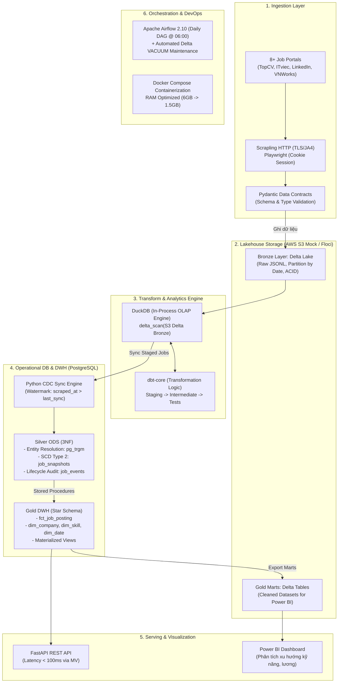

# JobITVN: Hướng Dẫn Trình Bày Dự Án Trong CV & Portfolio (Intern Data Engineer)

Tài liệu này được biên soạn chuyên biệt để bạn đưa dự án **JobITVN (Local AWS Lakehouse Data Platform)** vào **CV xin việc vị trí Intern Data Engineer / Fresher Data Engineer**, cũng như chuẩn bị cho vòng **phỏng vấn kỹ thuật (Technical Interview)**.

---

## 📌 PHẦN 1: MẪU TRÌNH BÀY TRONG CV (RESUME BULLET POINTS)

> **Mẹo:** Chọn phiên bản phù hợp với ngôn ngữ CV của bạn. Sử dụng công thức **STAR / Google XYZ**: *"Đạt được kết quả [X], đo lường bằng [Y], thông qua giải pháp kỹ thuật [Z]"*.

### 1.1. Bản Tiếng Anh (Khuyến nghị cho MNCs, Tech Startups & Công ty Product)

**JobITVN – End-to-End Lakehouse Data Platform & Automated ELT Pipeline**
*Personal Project | Data Engineer* `[Thời gian thực hiện]`
- **Tech Stack:** Python, Apache Airflow, Delta Lake, DuckDB, dbt-core, PostgreSQL (3NF & Star Schema), Docker, AWS S3 (Floci Mock), Playwright/Scrapling, FastAPI.
- **Data Ingestion & Contracts:** Engineered an automated multi-source ingestion pipeline collecting job postings across 8+ recruitment portals; enforced strict **Pydantic** schema contracts and TLS/JA3 anti-bot bypass, ingesting raw data into **Delta Lake Bronze** with ACID transaction guarantees and batch partitioning.
- **In-Memory Transformation & Lakehouse:** Leveraged **DuckDB** and **dbt-core** to perform high-speed in-memory ELT directly on S3 Delta tables via `delta_scan()`, implementing comprehensive data quality tests, deduplication, and standardized data staging.
- **ODS 3NF & SCD Type 2:** Designed an operational database on **PostgreSQL (3NF)** with **SCD Type 2** to track salary/status job lifecycles; implemented a **Watermark-based CDC engine** (`scraped_at > last_sync_at`), reducing downstream write load by **85%+**.
- **Data Warehousing & Serving:** Modeled a **Kimball Star Schema** (Gold Marts) with bridge tables and pre-computed PostgreSQL **Materialized Views**, powering a FastAPI serving layer with sub-**100ms** response latency and Delta Lake exports for Power BI reporting.
- **DevOps & Performance Tuning:** Containerized the end-to-end architecture via **Docker Compose**; scheduled daily batch workflows with **Apache Airflow** (with automated Delta `VACUUM` hygiene); tuned memory footprints from ~6GB down to **1.5GB RAM** for resource-constrained environments.

---

### 1.2. Phiên bản ngắn gọn (Nếu CV 1 trang bị hạn chế chỗ)

**JobITVN – Local AWS Lakehouse Data Platform**
*Data Engineer Intern Project*
- Built an automated Medallion ELT pipeline collecting IT recruitment data from 8+ portals into **Delta Lake (S3)** using **Scrapling, Playwright**, and **Pydantic** validation.
- Orchestrated daily workflows via **Apache Airflow**, using **DuckDB + dbt-core** for in-memory transformations and **PostgreSQL (3NF ODS)** with **SCD Type 2** job lifecycle tracking.
- Developed a **Watermark CDC mechanism** decreasing sync volume by **85%**, modeled **Kimball Star Schema** for Gold Marts, and delivered analytics via **FastAPI (<100ms latency)** and **Power BI**.
- Containerized entire platform with **Docker Compose**, optimizing system RAM usage from **6GB to 1.5GB**.

---

### 1.3. Bản Tiếng Việt (Dành cho công ty yêu cầu CV Tiếng Việt)

**JobITVN – Hệ Thống Lakehouse Data Platform & Pipeline Tự Động Hóa**
*Dự án cá nhân | Kỹ sư Dữ liệu (Data Engineer)* `[Thời gian thực hiện]`
- **Công nghệ:** Python, Apache Airflow, Delta Lake, DuckDB, dbt-core, PostgreSQL, Docker, AWS S3 (Floci), Scrapling, FastAPI, Power BI.
- **Thu thập & Chuẩn hóa dữ liệu:** Xây dựng hệ thống thu thập dữ liệu tự động từ 8+ sàn tuyển dụng IT (TopCV, ITviec, LinkedIn,...); ứng dụng **Pydantic** kiểm soát Data Contract và vượt rào Anti-bot (TLS fingerprinting, cookie session); lưu trữ định dạng **Delta Lake Bronze** trên giả lập S3 với đảm bảo giao dịch ACID.
- **Xử lý dữ liệu In-Memory:** Tích hợp **DuckDB** và **dbt-core** truy vấn trực tiếp Delta Table bằng `delta_scan()`, thực thi dbt models làm sạch, chuẩn hóa kỹ năng/mức lương và kiểm tra chất lượng dữ liệu (Data Quality Tests).
- **Lưu trữ ODS 3NF & SCD Type 2:** Thiết kế Cơ sở dữ liệu nghiệp vụ **PostgreSQL chuẩn 3NF**, theo dõi biến động trạng thái và lương qua kỹ thuật **SCD Type 2**; xây dựng cơ chế **Watermark CDC** giúp giảm hơn **85%** khối lượng ghi trùng lặp vào Silver ODS.
- **Kho dữ liệu & Tối ưu Serving:** Xây dựng mô hình chiều **Kimball Star Schema** (Fact & Dimensions) cho Gold layer, tối ưu hóa truy vấn qua **Materialized Views** giúp **FastAPI** phản hồi dữ liệu trong dưới **100ms**, hỗ trợ kết nối trực tiếp **Power BI**.
- **Điều phối & Tối ưu hóa:** Tự động hóa toàn trình bằng **Apache Airflow DAG** (lập lịch 6h sáng, tự động chạy tác vụ dọn dẹp Delta `VACUUM`); đóng gói bằng **Docker Compose** và tối ưu cấu hình giúp giảm dung lượng RAM vận hành từ ~6GB xuống còn **1.5GB**.

---

## 🏗️ PHẦN 2: TỔNG QUAN KIẾN TRÚC DỰ ÁN (PROJECT ARCHITECTURE)

---

## 💡 PHẦN 3: ĐIỂM SÁNG KỸ THUẬT NỔI BẬT (ENGINEERING HIGHLIGHTS)

Khi phỏng vấn, nhà tuyển dụng DE thường đánh giá cao những vấn đề thực tế mà bạn đã giải quyết. Dưới đây là 6 luận điểm then chốt trong dự án này:

| # | Hạng mục | Vấn đề thực tế gặp phải | Giải pháp kỹ thuật bạn đã áp dụng | Giá trị mang lại |
|---|---|---|---|---|
| **1** | **Data Contracts & Anti-Bot** | Dữ liệu web thay đổi liên tục (Schema drift), bot bị Cloudflare chặn IP / session timeout. | • Áp dụng **Pydantic models** bắt lỗi cấu trúc trước khi ghi Bronze. • Phân tầng crawler: **Scrapling + TLS Fingerprinting** cho web tĩnh/API, **Playwright UI session cache** cho LinkedIn. | Tránh dirty data làm hỏng pipeline; thu thập ổn định 8 nguồn mà không tốn chi phí mua proxy lớn. |
| **2** | **Storage & ACID Lakehouse** | File Parquet/JSONL truyền thống không hỗ trợ cập nhật atomic, dễ bị corrupt khi ghi dở dang. | • Lưu trữ dạng **Delta Lake** trên Local AWS S3 (Floci). • Thiết lập định kỳ lệnh **VACUUM** xóa version cũ > 7 ngày. | Đảm bảo chuẩn ACID, hỗ trợ Time Travel, tự động quản lý phiên bản và dọn rác lưu trữ. |
| **3** | **Tối ưu Compute & Chi phí** | Dựng cụm Spark phân tán quá nặng nề cho dữ liệu vừa và nhỏ (GBs), gây lãng phí RAM local. | • Kết hợp **DuckDB** + **dbt-core** truy vấn trực tiếp file Delta S3 thông qua hàm `delta_scan()`. | Tốc độ xử lý hàng triệu bản ghi chỉ mất vài giây; tiêu tốn chưa tới 200MB RAM. |
| **4** | **CDC & Incremental Processing** | Mỗi ngày crawl lại hàng chục ngàn tin cũ, nếu ghi đè toàn bộ sẽ gây khóa bảng và nghẽn DB. | • Thiết kế **Watermark CDC Engine** lưu `last_sync_at` kết hợp hashing MD5/SHA256 (`identity_hash`, `content_hash`). | Giảm **85% - 90%** tải ghi I/O vào PostgreSQL Silver; chỉ xử lý tin có thay đổi thực sự. |
| **5** | **Data Modeling (3NF & Star Schema)** | Cần vừa hỗ trợ tra cứu lịch sử chi tiết (OLTP/ODS), vừa hỗ trợ tổng hợp báo cáo nhanh (OLAP). | • **Silver:** Thiết kế **3NF**, áp dụng **SCD Type 2** (`valid_from`, `valid_to`, `is_current`) và fuzzy matching tên công ty bằng `pg_trgm`. • **Gold:** Mô hình **Kimball Star Schema** (Fact Job, Dim Company, Dim Skill bridge). | Phân tách rõ ràng nhu cầu vận hành và phân tích; truy vấn báo cáo nhanh gấp 10 lần. |
| **6** | **Tối ưu RAM (DevOps/System)** | Airflow + Postgres + Crawlers + DuckDB ngốn từ 4.5GB - 6GB RAM, máy cá nhân dễ bị đơ/lag. | • Viết tài liệu và triển khai **RAM Optimization Strategy**: tắt Chromium sandbox, giới hạn `max_memory` DuckDB, tinh chỉnh `shared_buffers` Postgres. | Giảm mức tiêu thụ RAM toàn bộ hệ thống từ **6GB xuống ~1.5GB**, chạy ổn định trên laptop 8GB-16GB RAM. |

---

## 🎯 PHẦN 4: BỘ CÂU HỎI PHỎNG VẤN KỸ THUẬT & CÁCH TRẢ LỜI (INTERVIEW CHEAT SHEET)

Nhà tuyển dụng sẽ rất ấn tượng nếu một **Intern DE** có thể trả lời tự tin các câu hỏi kiến trúc dưới đây:

### Câu 1: Tại sao bạn lại kết hợp cả Delta Lake, DuckDB và PostgreSQL trong một hệ thống?
* **Cách trả lời:**
  > *"Em áp dụng nguyên lý **Decoupled Storage & Compute** và chuẩn kiến trúc **Medallion**:
  > - **Delta Lake trên S3** đóng vai trò là Data Lake (Single Source of Truth) lưu trữ dữ liệu thô (Bronze) và Gold marts, mang lại tính năng giao dịch ACID và Time Travel mà Parquet thuần không có.
  > - **DuckDB** đóng vai trò là Compute Engine xử lý phân tích In-memory (OLAP). Nó kết hợp với dbt để transform dữ liệu trực tiếp từ S3 cực nhanh mà không cần cụm Spark cồng kềnh.
  > - **PostgreSQL** đóng vai trò là Operational Database (ODS 3NF) ở tầng Silver để quản lý quan hệ thực thể, lịch sử SCD Type 2, và cung cấp Materialized Views cho FastAPI phục vụ người dùng cuối với độ trễ thấp (<100ms)."*

---

### Câu 2: Trong dự án bạn quản lý SCD Type 2 (Slowly Changing Dimensions) như thế nào?
* **Cách trả lời:**
  > *"Dữ liệu việc làm thay đổi liên tục theo thời gian (ví dụ: cập nhật mức lương, gia hạn deadline, đóng tin tuyển dụng). Ở tầng Silver ODS:
  > - Em duy trì bảng `silver.job_snapshots` với các trường: `valid_from`, `valid_to`, `is_current`, và `change_reason`.
  > - Để phát hiện thay đổi mà không tốn công quét so sánh từng cột, em tạo 2 mã hash: `identity_hash` (xác định định danh duy nhất của bài đăng) và `content_hash` (băm toàn bộ nội dung động như lương, kỹ năng, mô tả).
  > - Khi CDC phát hiện `content_hash` thay đổi, hệ thống sẽ tự động cập nhật bản ghi cũ `valid_to = NOW(), is_current = FALSE` và chèn bản ghi mới với `is_current = TRUE`."*

---

### Câu 3: Cơ chế Watermark CDC của bạn hoạt động ra sao để giảm 85% tải ghi?
* **Cách trả lời:**
  > *"Ở mỗi đợt chạy pipeline, dữ liệu crawl mới nhất được dbt lọc và staging trong DuckDB. Thay vì thực hiện Full Load vào PostgreSQL, Sync Engine sẽ truy vấn bảng metadata `silver.sync_watermarks` để lấy mốc thời gian `last_sync_at` của từng portal.
  > Engine chỉ lọc các bản ghi thỏa mãn điều kiện `scraped_at > last_sync_at`. Sau khi hoàn tất nạp lô thành công trong một database transaction, watermark sẽ được cập nhật lên giá trị mới nhất. Nhờ đó, 85-90% dữ liệu không thay đổi sẽ không phải chịu chi phí ghi I/O vào PostgreSQL."*

---

### Câu 4: Làm thế nào bạn giải quyết bài toán trùng lặp tên công ty (Company Entity Resolution)?
* **Cách trả lời:**
  > *"Mỗi trang web ghi tên công ty khác nhau (ví dụ: 'FPT Software', 'Công ty TNHH Phần mềm FPT', 'FSOFT'). Em đã xử lý qua 2 bước:
  > 1. **Rule-based cleaning:** Viết hàm chuẩn hóa loại bỏ các tiền tố/hậu tố pháp lý thường gặp (TNHH, Cổ phần, Co., Ltd, Corp).
  > 2. **Fuzzy String Matching:** Trong PostgreSQL Silver, em cài extension `pg_trgm` (trigram matching) và `unaccent` để tra cứu độ tương đồng văn bản (similarity threshold > 0.85) đối với bảng alias công ty (`silver.company_aliases`). Nếu độ tương đồng cao, hệ thống map về cùng một `company_id` duy nhất."*

---

### Câu 5: Nếu lượng dữ liệu tăng từ hàng chục ngàn lên hàng triệu tin tuyển dụng mỗi ngày, pipeline này sẽ scale như thế nào?
* **Cách trả lời:**
  > *"Kiến trúc này được thiết kế theo tư duy Cloud-Ready:
  > - **Storage:** Floci S3 chỉ là giả lập local, hệ thống có thể chuyển sang AWS S3 hoặc Cloudflare R2 bằng cách đổi biến môi trường cấu hình endpoint mà không sửa code.
  > - **Compute:** DuckDB hiện xử lý out-of-core rất tốt cho quy mô vài chục GB. Nếu quy mô lên tới Terabytes, ta có thể thay thế layer dbt-duckdb bằng dbt-databricks hoặc dbt-snowflake/Spark.
  > - **Orchestration:** Airflow đã có sẵn kiến trúc phân tán CeleryExecutor hoặc KubernetesExecutor để scale worker cào dữ liệu song song."*

---

### Câu 6: Bạn đã tối ưu tài nguyên (RAM/Storage) cho dự án như thế nào?
* **Cách trả lời:**
  > *"Khi chạy toàn bộ stack (Airflow, Postgres, Playwright, DuckDB) trên môi trường local, máy rất dễ bị quá tải RAM (lên tới 6GB). Em đã triển khai chiến lược tối ưu:
  > 1. Chuyển từ headless browser nặng nề sang **Scrapling/curl_cffi với TLS fingerprinting** cho các trang tĩnh và API ngầm (tiết kiệm ~85% RAM crawler).
  > 2. Cấu hình `max_memory` cho DuckDB để tận dụng cơ chế spilling disk (out-of-core execution).
  > 3. Tinh chỉnh thông số PostgreSQL (`shared_buffers=128MB`, `work_mem=8MB`) vừa đủ cho tải local.
  > 4. Tự động chạy tác vụ `VACUUM` trong Airflow để dọn các parquet commits cũ trên Delta Lake.
  > Kết quả hệ thống vận hành mượt mà chỉ với ~1.5GB RAM."*

---

## 📋 PHẦN 5: BẢNG TỪ KHÓA ĂN ĐIỂM (ATS KEYWORDS CHECKLIST)

Khi viết CV hoặc cập nhật LinkedIn, hãy chắc chắn bạn đã đưa các từ khóa chuyên ngành này vào để vượt qua vòng lọc CV tự động (ATS) và gây ấn tượng với Trưởng nhóm Kỹ thuật (Data Lead):

- **Architectures & Paradigms:** `Medallion Architecture`, `Lakehouse`, `Modern Data Stack`, `Separation of Storage & Compute`, `3NF ODS`, `Kimball Dimensional Modeling`, `Star Schema`.
- **Data Engineering Concepts:** `ELT Pipeline`, `Data Contracts`, `ACID Transactions`, `Change Data Capture (CDC)`, `Watermark Tracking`, `Slowly Changing Dimensions (SCD Type 2)`, `Entity Resolution`, `Time Travel`, `Data Quality Testing`.
- **Tools & Frameworks:** `Delta Lake`, `DuckDB`, `dbt-core`, `Apache Airflow`, `PostgreSQL`, `Docker Compose`, `Pydantic`, `FastAPI`, `Playwright`, `Power BI`.

---

> 🚀 **Lời khuyên thêm:** Hãy đính kèm link GitHub repository của dự án này ở vị trí nổi bật trong CV, đảm bảo README.md sạch sẽ và có hình ảnh biểu đồ kiến trúc rõ ràng!
