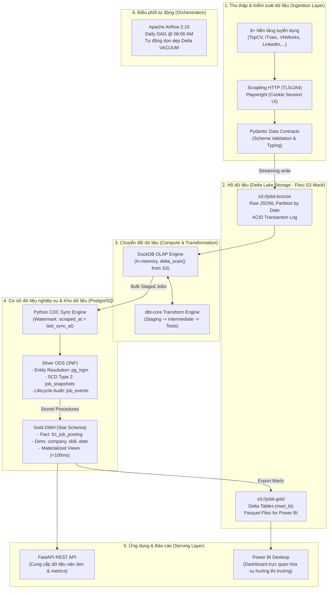

# JobITVN: Local AWS Lakehouse Data Platform & Automated ELT Pipeline

<div align="center">


**Nền tảng Lakehouse phân tích thị trường việc làm IT Việt Nam theo chuẩn Modern Data Stack.**  
*Tách biệt hoàn toàn Storage (S3 Delta Lake) & Compute (DuckDB/PostgreSQL), tự động hóa toàn trình với Airflow và tối ưu hóa tài nguyên phần cứng.*

[Kiến trúc hệ thống](#-kiến-trúc-hệ-thống-medallion-lakehouse) • [Công nghệ sử dụng](#-ngăn-xếp-công-nghệ-modern-data-stack) • [Điểm sáng kỹ thuật](#-điểm-sáng-kỹ-thuật-engineering-highlights) • [Hướng dẫn cài đặt](#-hướng-dẫn-cài-đặt--vận-hành-docker) • [Cấu trúc mã nguồn](#-cấu-trúc-thư-mục-dự-án)

</div>

---

## 📖 Giới thiệu dự án (Overview)

Thị trường tuyển dụng IT tại Việt Nam phân mảnh trên nhiều nền tảng với dữ liệu phi cấu trúc, trùng lặp cao và cơ chế chặn bot (Anti-bot) khắt khe. **JobITVN** được thiết kế như một **Enterprise-grade Data Platform** thu nhỏ chạy hoàn toàn trên máy cá nhân (Local Environment) nhằm giải quyết bài toán:

1. **Thu thập dữ liệu đa nguồn:** Tự động hóa crawl từ **8+ nền tảng tuyển dụng** hàng đầu (TopCV, ITviec, VietnamWorks, LinkedIn,...) với cơ chế Data Contracts và chống bot chuyên sâu.
2. **Kiến trúc Lakehouse chuẩn Medallion:** Phân tầng dữ liệu rõ ràng (**Bronze $\rightarrow$ Silver $\rightarrow$ Gold**), kết hợp định dạng **Delta Lake (ACID)** trên S3 và **PostgreSQL (3NF ODS)**.
3. **Phân tách Storage & Compute:** Tận dụng **DuckDB** làm In-Memory OLAP Engine kết hợp **dbt-core** để chuyển đổi dữ liệu tốc độ cao trực tiếp từ file Delta mà không cần cụm Spark cồng kềnh.
4. **Theo dõi vòng đời tin tuyển dụng:** Xử lý **SCD Type 2** và ghi nhận lịch sử biến động lương/deadline/trạng thái tin (`job_snapshots`).
5. **Tối ưu tài nguyên cực hạn:** Vận hành toàn bộ hệ thống (Airflow, Postgres, Floci S3, DuckDB, FastAPI) mượt mà với chỉ **~1.5GB RAM** (thay vì 4.5GB - 6GB như cấu hình mặc định).

---

## 🏗️ Kiến trúc hệ thống (Medallion Lakehouse)

Pipeline vận hành theo mô hình **Medallion Architecture**, tách biệt hoàn toàn giữa lớp lưu trữ (**Storage Layer**) và lớp tính toán (**Compute Layer**):



---

## 🛠️ Ngăn xếp công nghệ (Modern Data Stack)

| Thành phần | Công nghệ | Vai trò kỹ thuật trong hệ thống |
|---|---|---|
| **Orchestration** | **Apache Airflow 2.10** | Lập lịch pipeline hàng ngày, quản lý task dependencies, retry, metrics XCom và tự động thực thi task dọn dẹp `VACUUM`. |
| **Data Scraping** | **Scrapling & Playwright** | Phân tầng thu thập: `Scrapling` + TLS Fingerprint cho web tĩnh và API; `Playwright` quản lý session cookie cho LinkedIn. |
| **Data Quality** | **Pydantic v2** | Thiết lập **Data Contracts** nghiêm ngặt, validate kiểu dữ liệu và schema ngay tại nguồn trước khi ghi vào hồ dữ liệu. |
| **Lakehouse Storage** | **Delta Lake (S3 Mock)** | Lưu trữ định dạng **Delta Tables** trên Floci (AWS S3 mock); đảm bảo giao dịch ACID, schema evolution và time travel. |
| **Compute Engine** | **DuckDB 1.1+** | Analytical In-Memory Engine quét trực tiếp file Delta S3 thông qua hàm `delta_scan()`, xử lý hàng triệu dòng với bộ nhớ <200MB. |
| **Transformation** | **dbt-core 1.8+** | Quản lý logic biến đổi dữ liệu bằng SQL (Staging, Intermediate, Marts), data tests và dbt Semantic Layer (MetricFlow). |
| **Operational DB** | **PostgreSQL 17 (3NF)** | Lưu trữ lớp **Silver ODS** chuẩn 3NF, xử lý lịch sử **SCD Type 2** (`job_snapshots`) và fuzzy matching tên công ty bằng `pg_trgm`. |
| **Data Warehouse** | **PostgreSQL (Star Schema)** | Lớp **Gold DWH** gồm Fact & Dimension tables, tối ưu hóa truy vấn bằng **Materialized Views**. |
| **Serving Layer** | **FastAPI** | REST API cung cấp dữ liệu phân tích và việc làm với độ trễ phản hồi cực thấp (<100ms). |
| **Business Intelligence**| **Power BI Desktop** | Dashboard trực quan hóa xu hướng công nghệ, mức lương và nhu cầu tuyển dụng IT. |
| **Containerization** | **Docker & Docker Compose**| Đóng gói và cô lập toàn bộ môi trường thực thi, tinh chỉnh cấu hình RAM tối ưu cho máy tính cá nhân. |

---

## ✨ Điểm sáng kỹ thuật (Engineering Highlights)

### 1. Data Contracts & Chiến lược chống bot đa tầng
* **Kiểm duyệt cấu trúc với Pydantic:** Mọi dữ liệu thu thập được phải vượt qua kiểm tra Data Contract (Schema validation, regex, type checking). Dữ liệu sai lệch được đánh dấu và cách ly để tránh làm ô nhiễm Data Lake.
* **Chiến thuật thu thập phân cấp:**
  * *Tầng 1 (Siêu nhẹ):* Dùng `Scrapling HTTP` kết hợp giả lập TLS/JA3/JA4 fingerprint (`curl_cffi`) cho các trang SSR và REST API ngầm (TopCV, VietnamWorks, CareerViet).
  * *Tầng 2 (Trình duyệt thực tế):* Dùng `Playwright` với cơ chế lưu trữ **Session Cookie** (`data/auth/linkedin_session.json`) để vượt qua cơ chế chống bot khắt khe của LinkedIn mà không bị khóa tài khoản.

### 2. Hồ dữ liệu Delta Lake & Giao dịch ACID
* Dữ liệu thô Bronze được ghi dưới dạng **Delta Tables** phân vùng theo ngày thu thập (`_batch_date`).
* Hỗ trợ đầy đủ **ACID Transactions**, loại bỏ hoàn toàn rủi ro dữ liệu bị hỏng (corrupted) khi quá trình nạp bị ngắt quãng giữa chừng.
* Tích hợp tác vụ **`VACUUM`** định kỳ trong Airflow để tự động dọn dẹp các parquet files và transaction logs cũ hơn 7 ngày, giải phóng dung lượng đĩa cứng.

### 3. In-Memory ELT với DuckDB & dbt
* Thay vì dựng cụm Spark đồ sộ ngốn nhiều GB RAM, dự án tích hợp **DuckDB** đóng vai trò Compute Engine.
* DuckDB đọc trực tiếp Delta Tables trên S3 thông qua extension `delta` (`SELECT * FROM delta_scan('s3://...')`), kết hợp với **dbt-core** để làm sạch, chuẩn hóa kỹ năng, mức lương và chạy data quality tests.

### 4. Cơ chế Watermark CDC & SCD Type 2
* **Watermark CDC Engine:** Hệ thống theo dõi mốc thời gian `scraped_at > last_sync_at` cho từng nguồn tuyển dụng, kết hợp băm nội dung (`content_hash`) và định danh (`identity_hash`). Nhờ đó, **giảm hơn 85% - 90% khối lượng ghi I/O dư thừa** vào PostgreSQL Silver.
* **SCD Type 2 (Job Lifecycles):** Bảng `silver.job_snapshots` ghi nhận toàn bộ vòng đời của tin tuyển dụng (`valid_from`, `valid_to`, `is_current`, `change_reason`) khi có thay đổi về lương, kỹ năng yêu cầu hoặc khi tin tuyển dụng hết hạn/đóng.
* **Fuzzy Entity Resolution:** Tích hợp PostgreSQL extensions `pg_trgm` (trigram similarity) và `unaccent` để tự động gom nhóm tên công ty viết tắt hoặc sai chính tả về cùng một thực thể `company_id`.

### 5. Tối ưu hóa tài nguyên phần cứng (RAM Optimization)
* Áp dụng chiến lược tối ưu chuyên sâu (xem chi tiết tại [RAM_OPTIMIZATION_STRATEGY.md](docs/RAM_OPTIMIZATION_STRATEGY.md)):
  * Cắt giảm headless browser nặng nề sang request giả lập TLS.
  * Tinh chỉnh `shared_buffers=128MB` và `work_mem=8MB` cho PostgreSQL.
  * Giới hạn `max_memory` cho DuckDB để kích hoạt cơ chế out-of-core execution (spilling disk).
* **Kết quả:** Giảm mức tiêu thụ RAM toàn hệ thống từ **~6GB xuống còn ~1.5GB**, chạy ổn định trên laptop cá nhân.

---

## 🌐 Các nguồn tuyển dụng đang hỗ trợ

| Nguồn (Portal) | Tên miền | Mức độ Anti-bot | Chiến lược thu thập (Strategy) | Định dạng trích xuất |
|---|---|---|---|---|
| **TopCV** | `topcv.vn` | Trung bình | `Scrapling HTTP` (HTML Parsing) | JSON $\rightarrow$ Delta Bronze |
| **ITviec** | `itviec.com` | Thấp | `Scrapling HTTP` (HTML Parsing) | JSON $\rightarrow$ Delta Bronze |
| **VietnamWorks**| `vietnamworks.com` | Trung bình | `REST API` (Reverse Engineered Internal API)| JSON $\rightarrow$ Delta Bronze |
| **JobsGO** | `jobsgo.vn` | Thấp | `Scrapling HTTP` (HTML Parsing) | JSON $\rightarrow$ Delta Bronze |
| **Joboko** | `joboko.com` | Thấp | `Scrapling HTTP` (HTML Parsing) | JSON $\rightarrow$ Delta Bronze |
| **123job** | `123job.vn` | Trung bình | `Scrapling HTTP` (HTML Parsing) | JSON $\rightarrow$ Delta Bronze |
| **CareerViet** | `careerviet.vn` | Trung bình | `Scrapling HTTP` (HTML Parsing) | JSON $\rightarrow$ Delta Bronze |
| **LinkedIn** | `linkedin.com` | **Rất Khắc Nghiệt** | `Playwright` + **Session Cookie Persistence** | JSON $\rightarrow$ Delta Bronze |

---

## 🚀 Hướng dẫn Cài đặt & Vận hành (Docker)

### 1. Yêu cầu tiên quyết (Prerequisites)
* Đã cài đặt [Git](https://git-scm.com/) và [Docker Desktop](https://www.docker.com/products/docker-desktop/) (hỗ trợ WSL2 trên Windows).
* Cấp phát tối thiểu 4GB RAM cho Docker Engine.

### 2. Clone dự án và Cấu hình môi trường
```bash
# Clone repository
git clone https://github.com/chuong1104/CrawlJobITHaNoi.git
cd CrawlJobITHaNoi

# Tạo file môi trường từ template
cp .env.example .env
```

### 3. Phân quyền thư mục lưu trữ (Linux / macOS / WSL2)
```bash
mkdir -p logs data/floci data/auth
chmod -R 777 logs data
```

### 4. Khởi chạy hệ thống bằng Docker Compose
Để đảm bảo máy không bị quá tải tài nguyên, hãy khởi chạy các dịch vụ theo 2 bước:
```bash
# Bước 4.1: Khởi chạy Database và S3 Mock trước
docker compose up -d postgres floci

# Bước 4.2: Khởi chạy tiếp Airflow (Webserver, Scheduler, DAGs)
docker compose up -d airflow
```

* **Airflow Web UI:** [http://localhost:8080](http://localhost:8080) *(Tài khoản: `admin` / Mật khẩu: `admin`)*
* **PostgreSQL:** `localhost:5432` *(User: `airflow`, Database: `job_scraper_db`)*
* **Floci S3 Mock:** `http://localhost:4566`

---

### 5. Khởi tạo Database Schemas & S3 Buckets
Chạy migration tạo bảng ODS 3NF, CDC Watermark, Gold Star Schema và Materialized Views:

```bash
# Tạo schema Silver ODS (3NF, SCD2 tables)
docker compose exec airflow psql -U airflow -d job_scraper_db -f /opt/airflow/scripts/sql/silver/01_create_silver_schema.sql

# Tạo bảng CDC Watermark & audit logs
docker compose exec airflow psql -U airflow -d job_scraper_db -f /opt/airflow/scripts/sql/silver/02_create_cdc_tables.sql

# Tạo schema Gold DWH (Star Schema)
docker compose exec airflow psql -U airflow -d job_scraper_db -f /opt/airflow/scripts/sql/gold/01_create_gold_dwh_schema.sql

# Tạo Materialized Views tối ưu cho API Serving
docker compose exec airflow psql -U airflow -d job_scraper_db -f /opt/airflow/scripts/sql/gold/02_create_materialized_views.sql

# Khởi tạo các S3 Delta Lake buckets (jobit-bronze, jobit-gold)
docker compose exec airflow env PYTHONPATH=/opt/airflow python -m src.storage.init_buckets
```

---

### 6. Thực thi Pipeline thủ công (CLI Execution)

Bạn có thể kích hoạt DAG trên giao diện Airflow Web UI hoặc chạy thủ công từng công đoạn:

```bash
# 1. Thu thập dữ liệu từ các nguồn (Extract & Load lên Delta Bronze S3)
docker compose exec airflow env PYTHONPATH=/opt/airflow python /opt/airflow/scripts/run_scrapers.py --mode full --workers 3

# 2. Chạy dbt Transformation (Staging & Intermediate qua DuckDB)
docker compose exec airflow dbt run --select staging intermediate --profiles-dir ./dbt_jobitvn --project-dir ./dbt_jobitvn

# 3. Đồng bộ dữ liệu vào PostgreSQL Silver 3NF & Cập nhật SCD Type 2 qua Sync Engine
docker compose exec airflow env PYTHONPATH=/opt/airflow python -m src.silver.sync_engine

# 4. Xuất dữ liệu Gold Marts ra Delta Lake trên S3 cho Power BI
docker compose exec airflow env PYTHONPATH=/opt/airflow python -m src.gold.exporter
```

---

### 7. Thiết lập Cookie đăng nhập cho LinkedIn (Tùy chọn)
Đối với LinkedIn, chạy script hỗ trợ tương tác một lần trên môi trường máy chủ/local:
```bash
python scripts/login_linkedin_interactive.py
```
> Cookie hợp lệ sẽ được lưu tự động tại `data/auth/linkedin_session.json` (được bảo mật và tự động bỏ qua trong `.gitignore`).

---

## 📁 Cấu trúc thư mục dự án

```text
job_scraper_de_project/
├── dags/
│   └── daily_pipeline.py         # Airflow DAG điều phối toàn trình (Daily @ 06:00 AM)
├── dbt_jobitvn/                  # Dự án dbt-core
│   ├── models/                   # SQL Transformations (staging, intermediate, marts)
│   ├── seeds/                    # Dữ liệu tĩnh (danh mục kỹ năng chuẩn, địa điểm)
│   └── dbt_project.yml           # Cấu hình project dbt
├── src/                          # Mã nguồn chính của nền tảng (Core Logic)
│   ├── extract/                  # Các module Scraper (TopCV, ITviec, LinkedIn, VNWorks...)
│   ├── schema/                   # Pydantic Data Contracts & Schema Validation
│   ├── storage/                  # Trình quản lý Delta Lake S3 (ACID, Partitioning, VACUUM)
│   ├── silver/                   # Watermark CDC Tracker & 3NF ODS Sync Engine
│   ├── lifecycle/                # Logic xử lý sự kiện và cập nhật lịch sử SCD Type 2
│   ├── gold/                     # Exporter dữ liệu DWH sang Delta Lake Marts
│   ├── api/                      # Ứng dụng FastAPI serving endpoints
│   ├── config.py                 # Quản lý cấu hình tập trung và biến môi trường
│   └── utils.py                  # Tiện ích bổ trợ (Logger, Chuẩn hóa văn bản Unicode)
├── scripts/                      # DDL Scripts & SQL Migrations (Silver 3NF, Gold DWH, MVs)
├── docs/                         # Tài liệu thiết kế kiến trúc, Data Marts và tối ưu hóa
│   ├── 02_system_architecture.md # Chi tiết kiến trúc hệ thống
│   ├── RAM_OPTIMIZATION_STRATEGY.md # Chiến lược tối ưu RAM từ 6GB -> 1.5GB
│   └── power_bi_integration_guide.md # Hướng dẫn kết nối và tạo Dashboard Power BI
├── CV_PROJECT_SHOWCASE.md        # Hướng dẫn trình bày dự án trong CV & bộ câu hỏi phỏng vấn DE
├── docker-compose.yml            # File cấu hình khởi chạy toàn bộ dịch vụ
├── requirements.txt              # Danh mục thư viện Python phụ thuộc
└── README.md                     # Tài liệu tổng quan dự án
```

---

## 🎯 Ứng dụng trong hồ sơ nghề nghiệp (Career & Portfolio)

Dự án này là minh chứng thực tế về năng lực thiết kế và triển khai một **Data Platform hoàn chỉnh theo chuẩn doanh nghiệp**. 

* 📄 Để tham khảo **mẫu bullet points đưa vào CV (chuẩn STAR / Google XYZ)**, phân tích chuyên sâu các quyết định kiến trúc và **bộ câu hỏi phỏng vấn kỹ thuật (Interview Cheat Sheet)**, vui lòng xem tài liệu:
  👉 **[CV_PROJECT_SHOWCASE.md](file:///d:/JobITVN/job_scraper_de_project/CV_PROJECT_SHOWCASE.md)**

---

## 📜 Giấy phép (License)

Dự án được phân phối dưới giấy phép **MIT License**. Mọi đóng góp (Pull Request, Issue) đều được hoan nghênh!
