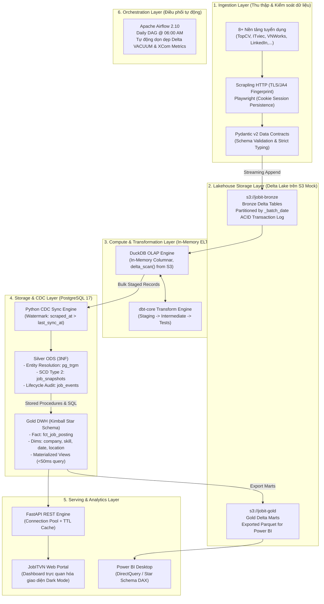

# 🚀 JobITVN: Enterprise Medallion Lakehouse & Automated ELT Platform

<div align="center">


**Nền tảng Lakehouse phân tích thị trường việc làm IT Việt Nam theo chuẩn Modern Data Stack.**  
*Tách biệt hoàn toàn Storage (S3 Delta Lake) & Compute (DuckDB / PostgreSQL), tự động hóa toàn trình với Airflow, CDC Watermark, SCD Type 2 và tối ưu tài nguyên phần cứng (vận hành chỉ với ~1.5GB RAM).*

[Kiến trúc hệ thống](#-kiến-trúc-hệ-thống-medallion-lakehouse) • [Chỉ số kỹ thuật](#-chỉ-số-kỹ-thuật-ấn-tượng-key-metrics) • [Điểm sáng kỹ thuật](#-điểm-sáng-kỹ-thuật-engineering-highlights) • [Mô hình dữ liệu](#-mô-hình-hóa-dữ-liệu-data-modeling) • [Cài đặt & Vận hành](#-hướng-dẫn-cài-đặt--vận-hành-quickstart)

</div>

---

## 📌 Tổng quan dự án (Executive Summary)

Thị trường tuyển dụng IT tại Việt Nam có tính chất phân mảnh cao trên nhiều nền tảng (TopCV, ITviec, VietnamWorks, LinkedIn,...), đi kèm với dữ liệu phi cấu trúc, trùng lặp lớn và cơ chế chống bot (Anti-bot) nghiêm ngặt. 

**JobITVN** được thiết kế như một **Enterprise Data Platform** hoàn chỉnh thu nhỏ chạy trơn tru trên môi trường cá nhân (Local Machine) nhưng sở hữu 100% tính tương thích để triển khai lên hạ tầng đám mây (AWS Cloud-Native). Dự án giải quyết trọn vẹn chuỗi giá trị dữ liệu từ Thu thập $\rightarrow$ Lưu trữ Lakehouse $\rightarrow$ Chuyển đổi ELT $\rightarrow$ Lưu kho DWH $\rightarrow$ Cung cấp dữ liệu (Serving Layer).

### 📊 Chỉ số kỹ thuật ấn tượng (Key Metrics)

| Chỉ số | Giá trị đạt được | Ý nghĩa kỹ thuật |
|---|---|---|
| **Cổng tuyển dụng** | **8+ nền tảng** | Thu thập tự động: TopCV, ITviec, VietnamWorks, LinkedIn, CareerViet, JobsGO, Joboko, 123job. |
| **Mức tiêu thụ RAM** | **~1.5 GB RAM** | Tiết kiệm **~75% RAM** so với kiến trúc mặc định (~6GB), chạy ổn định trên laptop cá nhân. |
| **Độ tin cậy Lakehouse** | **100% ACID** | Delta Lake transaction logs (`_delta_log`), schema enforcement, time-travel và tự động dọn dẹp `VACUUM`. |
| **Tiết kiệm I/O Database** | **Giảm 85% - 90%** | Watermark CDC kết hợp cơ chế băm kép (`identity_hash` & `content_hash`) loại bỏ hoàn toàn ghi trùng lặp. |
| **Tốc độ phản hồi API** | **< 50ms** | Tối ưu bằng Materialized Views, Connection Pooling (QueuePool) và In-Memory TTL Cache. |
| **Độ trễ xử lý OLAP** | **Vài giây / 100K dòng** | Tận dụng In-Memory Columnar Engine của DuckDB kết hợp `delta_scan()` từ S3 thay cho cụm Spark nặng nề. |

---

## 🏗️ Kiến trúc hệ thống (Medallion Lakehouse)

Pipeline vận hành theo mô hình **Medallion Architecture 3 tầng** kết hợp giữa Data Lakehouse (S3 Mock) và Relational Data Warehouse (PostgreSQL 17):



### 📋 Phân tầng kiến trúc Medallion (Data Layers)

| Tầng dữ liệu | Vị trí lưu trữ | Định dạng lưu trữ | Công nghệ xử lý | Mục đích & Đặc tả kỹ thuật |
|---|---|---|---|---|
| **Bronze** | `s3://jobit-bronze` | **Delta Lake** (Parquet + `_delta_log`) | Python `deltalake` | Lưu trữ dữ liệu thô nguyên bản theo ngày (`_batch_date`), bảo toàn 100% dữ liệu gốc, hỗ trợ time-travel và ACID. |
| **Silver** | PostgreSQL `silver` | **Relational 3NF ODS** | Python Sync Engine + SQL | Dữ liệu chuẩn hóa, chuẩn 3NF, theo dõi lịch sử biến động bằng **SCD Type 2**, khử trùng lặp công ty bằng `pg_trgm`. |
| **Gold** | PostgreSQL `dwh` & `s3://jobit-gold` | **Star Schema & Delta Tables** | dbt-core + PostgreSQL | Mô hình hóa theo chuẩn Kimball (Fact/Dimensions) và Materialized Views sẵn sàng cho phân tích BI và Serving API. |
| **Serving** | Memory & REST | JSON & Static Assets | FastAPI + HTML5/CSS3 | Phục vụ truy vấn thống kê kỹ năng, công ty, mức lương và hiển thị trực tiếp lên Web Dashboard với độ trễ <50ms. |

---

## 🛠️ Ngăn xếp công nghệ (Modern Data Stack)

```
┌────────────────────────────────────────────────────────────────────────┐
│                        MODERN DATA STACK (MDS)                         │
├───────────────────┬────────────────────────────────────────────────────┤
│ Orchestration     │ Apache Airflow 2.10 (LocalExecutor, gevent worker) │
│ Ingestion Layer   │ Scrapling (TLS/JA4 bypass) + Playwright (Sessions) │
│ Data Quality      │ Pydantic v2 (Strict Schema Contracts)              │
│ Lakehouse Storage │ Delta Lake (deltalake 0.18+) trên Floci (S3 Mock)  │
│ Compute Engine    │ DuckDB 1.1+ (In-Memory OLAP Vectorized Engine)     │
│ Data Transform    │ dbt-core 1.8+ (dbt-duckdb, dbt-postgres)           │
│ ODS & DWH         │ PostgreSQL 17 (3NF ODS & Kimball Star Schema)      │
│ Serving Layer     │ FastAPI (QueuePool, TTL Cache) + Static Dashboard  │
│ Business Intel    │ Power BI Desktop (DirectQuery & Star Schema DAX)   │
│ Containerization  │ Docker & Docker Compose v2 (RAM Tuned)             │
└───────────────────┴────────────────────────────────────────────────────┘
```

---

## ✨ Điểm sáng kỹ thuật (Engineering Highlights)

### 1. Thu thập đa tầng & Data Contracts nghiêm ngặt
* **Chiến thuật thu thập phân cấp (Multi-tier Strategy):**
  * *Tầng 1 (Siêu nhẹ):* Sử dụng `Scrapling HTTP` kết hợp giả lập TLS Fingerprint (JA3/JA4 qua `curl_cffi`) cho các trang SSR và REST API ngầm (TopCV, VietnamWorks, CareerViet, JobsGO). Tiêu thụ bộ nhớ chỉ **~30MB - 50MB/process** (nhẹ hơn 10 lần so với trình duyệt).
  * *Tầng 2 (Persistent Session):* Dùng `Playwright` với cơ chế lưu trữ **Cookie Session** (`data/auth/linkedin_session.json`) để vượt qua cơ chế chống bot khắt khe của LinkedIn mà không bị checkpoint tài khoản.
* **Pydantic Data Contracts:** Toàn bộ payload thu thập được phải pass qua Pydantic schema validation tại nguồn. Dữ liệu sai cấu trúc hoặc không hợp lệ bị cô lập ngay lập tức, ngăn ngừa hoàn toàn ô nhiễm Data Lake.

### 2. Hồ dữ liệu Delta Lake & Giao dịch ACID trên S3
* Khác với các dự án lưu trữ Parquet/JSON phẳng thông thường, JobITVN áp dụng chuẩn **Delta Lake (Open Table Format)**:
  * **ACID Transactions:** Mọi tác vụ ghi đều thông qua transaction log (`_delta_log`), ngăn chặn triệt để tình trạng file rác hỏng khi tiến trình cào dữ liệu gặp sự cố mạng giữa chừng.
  * **Partitioning & Schema Evolution:** Dữ liệu Bronze tự động phân vùng theo ngày thu thập (`_batch_date`).
  * **Automated VACUUM:** Tích hợp task Airflow định kỳ dọn dẹp các tệp Parquet và logs mồ côi cũ hơn 7 ngày, giải phóng dung lượng đĩa cứng tự động.

### 3. In-Memory ELT: DuckDB + dbt (Zero-Spark Architecture)
* Thay vì phải duy trì cụm Apache Spark cồng kềnh tiêu tốn 4GB–8GB RAM, dự án kết hợp **DuckDB** và **dbt-core**:
  * DuckDB đọc trực tiếp bảng Delta trên S3 bằng extension `delta` thông qua lệnh:
    ```sql
    SELECT * FROM delta_scan('s3://jobit-bronze/vietnamworks')
    ```
  * dbt-core thực hiện các logic bóc tách Regex mức lương, kinh nghiệm, chuẩn hóa kỹ năng và chạy dbt data tests.
  * Xử lý hàng trăm nghìn bản ghi chỉ trong vài giây với mức tiêu thụ RAM chưa tới **200MB**.

### 4. Watermark CDC Engine & Quản lý vòng đời tin (SCD Type 2)
* **Watermark CDC:** Hệ thống lưu vết mốc thời gian `last_sync_at` của từng cổng tuyển dụng trong bảng `silver.cdc_watermarks`. Trong các lần chạy tiếp theo, chỉ các bản ghi có `scraped_at > last_sync_at` mới được xử lý.
* **Cơ chế băm kép (Dual-Hash Strategy):**
  * `identity_hash = SHA256(source_code, company_raw, location_normalized, job_url)`: Định danh duy nhất công việc.
  * `content_hash = SHA256(title_clean, description, salary_min, salary_max, requirements, deadline)`: Giám sát thay đổi nội dung.
* **SCD Type 2 Lifecycle Tracking:** Khi phát hiện `identity_hash` trùng khớp nhưng `content_hash` thay đổi (công ty cập nhật mức lương, gia hạn deadline, sửa yêu cầu), hệ thống tự động:
  * Đóng bản ghi cũ (`valid_to = CURRENT_TIMESTAMP`, `is_current = false`).
  * Mở bản ghi snapshot mới (`valid_from = CURRENT_TIMESTAMP`, `is_current = true`, gán nhãn `change_reason`).
  * Ghi nhận sự kiện vào `silver.job_events` để phục vụ phân tích thời gian đóng tuyển dụng trung bình (Time-to-Fill).
* **Kết quả:** Giảm thiểu **85% - 90% lượng ghi I/O dư thừa** vào PostgreSQL ODS.

### 5. Fuzzy Entity Resolution bằng `pg_trgm` (Khử trùng lặp công ty)
* Tên công ty trên các website tuyển dụng thường không đồng nhất (ví dụ: *FPT Software*, *FPT Software Co., Ltd*, *Cong ty Phan mem FPT*).
* Hệ thống kích hoạt PostgreSQL extensions `pg_trgm` (Trigram Similarity) và `unaccent` để tự động chuẩn hóa chuỗi và tính toán điểm tương đồng (`similarity > 0.85`), tự động gom nhóm các biến thể về cùng một thực thể `company_id` duy nhất.

### 6. Tối ưu tài nguyên cực hạn: Giảm RAM từ 6GB xuống 1.5GB
Toàn bộ hệ thống được tinh chỉnh chuyên sâu để vận hành nhẹ nhàng trên máy tính cá nhân:
* **Airflow:** Chuyển sang `LocalExecutor`, giới hạn 1 worker với `gevent` class, `parsing_processes = 1`, tăng chu kỳ quét DAGs lên 60s.
* **PostgreSQL:** Tinh chỉnh `shared_buffers = 128MB`, `work_mem = 8MB`, `maintenance_work_mem = 64MB`.
* **DuckDB:** Giới hạn `max_memory = '512MB'` kích hoạt cơ chế spilling-to-disk (out-of-core execution) khi cần.
* Chi tiết toàn bộ chiến lược xem tại: [docs/RAM_OPTIMIZATION_STRATEGY.md](docs/RAM_OPTIMIZATION_STRATEGY.md).

---

## 🌐 Danh mục nguồn dữ liệu hỗ trợ

| Cổng tuyển dụng | Domain | Mức độ Anti-bot | Chiến lược thu thập (Strategy) | Định dạng nạp |
|---|---|---|---|---|
| **TopCV** | `topcv.vn` | Trung bình | `Scrapling HTTP` (HTML Extraction) | Delta Bronze |
| **ITviec** | `itviec.com` | Thấp | `Scrapling HTTP` (HTML Extraction) | Delta Bronze |
| **VietnamWorks** | `vietnamworks.com` | Trung bình | `REST API` (Reverse-engineered Internal API) | Delta Bronze |
| **CareerViet** | `careerviet.vn` | Trung bình | `Scrapling HTTP` (HTML Extraction) | Delta Bronze |
| **JobsGO** | `jobsgo.vn` | Thấp | `Scrapling HTTP` (HTML Extraction) | Delta Bronze |
| **Joboko** | `joboko.com` | Thấp | `Scrapling HTTP` (HTML Extraction) | Delta Bronze |
| **123job** | `123job.vn` | Trung bình | `Scrapling HTTP` (HTML Extraction) | Delta Bronze |
| **LinkedIn** | `linkedin.com` | **Rất Khắt Khe** | `Playwright` + **Session Cookie Persistence** | Delta Bronze |

---

## 📐 Mô hình hóa dữ liệu (Data Modeling)

### 1. Tầng Silver: Operational Data Store (3NF)
Tối ưu hóa cho tính toàn vẹn dữ liệu và ghi nhận lịch sử thay đổi:
* `silver.companies`: Danh mục công ty đã khử trùng lặp (Entity Resolution).
* `silver.jobs`: Thông tin định danh việc làm cố định (`identity_hash`, `canonical_url`).
* `silver.job_snapshots`: Lịch sử biến động theo chuẩn **SCD Type 2** (`salary_min`, `salary_max`, `valid_from`, `valid_to`, `is_current`).
* `silver.job_events`: Nhật ký sự kiện trạng thái việc làm (`POSTED`, `SALARY_CHANGED`, `CLOSED`, `REOPENED`).
* `silver.cdc_watermarks`: Quản lý mốc thời gian đồng bộ cho từng source.

### 2. Tầng Gold: Data Warehouse (Kimball Star Schema)
Tối ưu hóa cho truy vấn phân tích OLAP, BI Dashboard và REST API:
* **Fact Table:** `dwh.fct_job_posting` (Chứa các metrics: mức lương quy đổi VND, năm kinh nghiệm, cờ trạng thái hoạt động).
* **Dimension Tables:** 
  * `dwh.dim_company` (Tên công ty, quy mô, ngành nghề).
  * `dwh.dim_date` (Thông tin thời gian: ngày, tháng, năm, quý).
  * `dwh.dim_source` (Nguồn cào: TopCV, ITviec, VietnamWorks,...).
  * `dwh.dim_job_attributes` (Cấp bậc: Junior/Senior, loại hình: Full-time/Remote).
* **Bridge Tables (Quan hệ nhiều - nhiều):**
  * `dwh.bridge_job_skill` $\leftrightarrow$ `dwh.dim_skill` (Chuẩn hóa các kỹ năng: Python, Java, Docker, AWS,...).
  * `dwh.bridge_job_location` $\leftrightarrow$ `dwh.dim_location` (Chuẩn hóa tỉnh thành: Hà Nội, TP.HCM, Đà Nẵng).
* **Materialized Views:**
  * `dwh.mv_active_jobs_summary`: Tổng hợp nhanh việc làm đang mở.
  * `dwh.mv_salary_by_skill`: Phân tích phân vị lương theo từng kỹ năng kỹ thuật.
  * `mart_api.latest_jobs_flat`: Bảng phẳng tối ưu hóa truy vấn serving API <50ms.

---

## 💻 Serving Layer: Web Portal & REST API & BI

### 1. Web Portal Dashboard (`http://localhost:8000`)
Giao diện Web Portal hiện đại được tích hợp sẵn (HTML5/CSS3/Vanilla JS), phục vụ việc tìm kiếm việc làm, lọc theo công ty, mức lương, kinh nghiệm và thống kê trực quan.

### 2. FastAPI REST Engine (`http://localhost:8000/docs`)
* Tích hợp **SQLAlchemy Connection Pooling (QueuePool)** kiểm soát số lượng kết nối tối đa.
* Bộ nhớ đệm **In-Memory TTL Cache** cho các truy vấn phân tích nặng (Top skills, Company stats).

| Phương thức | Endpoint | Chức năng | Cơ chế tối ưu |
|---|---|---|---|
| `GET` | `/health` | Kiểm tra trạng thái API & Connection Pool | Direct ping |
| `GET` | `/jobs` | Danh sách tin tuyển dụng (Search, Filter, Pagination) | TTL Cache 120s |
| `GET` | `/jobs/{id}` | Chi tiết công việc & mô tả đầy đủ | Single-row indexed query |
| `GET` | `/stats/skills` | Thống kê Top N kỹ năng IT được săn đón nhiều nhất | TTL Cache 3600s |
| `GET` | `/stats/companies` | Thống kê Top N công ty có nhu cầu tuyển dụng lớn nhất | TTL Cache 3600s |
| `GET` | `/stats/locations` | Phân bố nhu cầu tuyển dụng theo khu vực địa lý | TTL Cache 3600s |

### 3. Power BI Integration
Báo cáo Power BI kết nối trực tiếp vào PostgreSQL Star Schema thông qua chế độ **DirectQuery** hoặc **Import Mode**:
* Hướng dẫn thiết lập chi tiết tại: [docs/power_bi_integration_guide.md](docs/power_bi_integration_guide.md).

---

## 🚀 Hướng dẫn Cài đặt & Vận hành (Quickstart)

### 1. Yêu cầu tiên quyết (Prerequisites)
* [Docker Desktop](https://www.docker.com/products/docker-desktop/) (hỗ trợ WSL2 trên Windows, Docker Compose v2).
* Máy tính tối thiểu 4GB RAM khả dụng.

### 2. Thiết lập môi trường
```bash
# 1. Clone repository
git clone https://github.com/chuong1104/CrawlJobITHaNoi.git
cd CrawlJobITHaNoi

# 2. Tạo file biến môi trường từ template
cp .env.example .env

# 3. Phân quyền thư mục lưu trữ (Linux / macOS / WSL2)
mkdir -p logs data/floci data/auth
chmod -R 777 logs data
```

### 3. Khởi chạy hệ thống bằng Docker Compose
Để đảm bảo tài nguyên hệ thống được giải phóng tuần tự, khởi động theo 2 bước:

```bash
# Bước 3.1: Khởi chạy Database, S3 Mock và Web API
docker compose up -d postgres floci web-api

# Bước 3.2: Khởi chạy Airflow Platform (Khởi tạo DB -> Webserver/Scheduler)
docker compose up -d airflow
```

### 4. Danh mục cổng dịch vụ & Tài khoản đăng nhập

| Dịch vụ | URL truy cập | Tài khoản / Mật khẩu | Chức năng |
|---|---|---|---|
| **Airflow Web UI** | [http://localhost:8080](http://localhost:8080) | `admin` / `admin` | Giám sát DAGs & Quản lý lịch chạy pipeline |
| **Web Portal** | [http://localhost:8000](http://localhost:8000) | Không yêu cầu | Giao diện tra cứu việc làm IT & Thống kê |
| **FastAPI Swagger** | [http://localhost:8000/docs](http://localhost:8000/docs) | Không yêu cầu | Tài liệu và thử nghiệm các REST endpoints |
| **PostgreSQL 17** | `localhost:5432` | `airflow` / `airflow` | CSDL lưu trữ Silver 3NF & Gold Star Schema |
| **Floci S3 Mock** | [http://localhost:4566](http://localhost:4566) | `test` / `test` | AWS S3 Mock lưu trữ Delta Lake Tables |

---

### 5. Khởi tạo Database Schemas & S3 Buckets

Thực thi một lần sau khi dựng container để tạo cấu trúc cơ sở dữ liệu:

```bash
# Tạo schema Silver ODS (3NF, SCD Type 2 tables)
docker compose exec airflow psql -U airflow -d job_scraper_db -f /opt/airflow/scripts/sql/silver/01_create_silver_schema.sql

# Tạo bảng CDC Watermark & audit logs
docker compose exec airflow psql -U airflow -d job_scraper_db -f /opt/airflow/scripts/sql/silver/02_create_cdc_tables.sql

# Tạo schema Gold DWH (Kimball Star Schema)
docker compose exec airflow psql -U airflow -d job_scraper_db -f /opt/airflow/scripts/sql/gold/01_create_gold_dwh_schema.sql

# Tạo Materialized Views tối ưu cho Serving API
docker compose exec airflow psql -U airflow -d job_scraper_db -f /opt/airflow/scripts/sql/gold/02_create_materialized_views.sql

# Khởi tạo các S3 Delta Lake buckets (jobit-bronze, jobit-gold)
docker compose exec airflow env PYTHONPATH=/opt/airflow python -m src.storage.init_buckets
```

---

### 6. Thực thi thủ công từng công đoạn (CLI Testing)

Bạn có thể kích hoạt DAG `daily_pipeline` trên Airflow Web UI hoặc chạy thủ công từng bước bằng CLI:

```bash
# 1. Thu thập dữ liệu từ các nguồn (Extract & ghi Delta Bronze S3)
docker compose exec airflow env PYTHONPATH=/opt/airflow python /opt/airflow/scripts/run_scrapers.py --mode full --workers 3

# 2. Chạy dbt Transformation (Staging & Intermediate qua DuckDB)
docker compose exec airflow dbt run --select staging intermediate --profiles-dir ./dbt_jobitvn --project-dir ./dbt_jobitvn

# 3. Đồng bộ dữ liệu vào PostgreSQL Silver 3NF & Cập nhật SCD Type 2 qua Sync Engine
docker compose exec airflow env PYTHONPATH=/opt/airflow python -m src.silver.sync_engine

# 4. Xuất dữ liệu Gold Marts ra Delta Lake trên S3 cho Power BI
docker compose exec airflow env PYTHONPATH=/opt/airflow python -m src.gold.exporter
```

> [!TIP]
> **Thiết lập Cookie cho LinkedIn:** Để bật thu thập LinkedIn, chạy script `python scripts/login_linkedin_interactive.py` một lần để sinh session cookie hợp lệ tại `data/auth/linkedin_session.json`.

---

## 📁 Cấu trúc mã nguồn dự án

```text
job_scraper_de_project/
├── .env.example                  # Template cấu hình biến môi trường
├── docker-compose.yml            # Khởi chạy dịch vụ (Postgres, Floci, Airflow, API)
├── Dockerfile                    # Container image tùy chỉnh cho platform
├── requirements.txt              # Danh mục thư viện Python phụ thuộc
│
├── dags/
│   └── daily_pipeline.py         # Airflow DAG điều phối toàn trình (06:00 AM hàng ngày)
│
├── dbt_jobitvn/                  # Dự án dbt-core (In-memory DuckDB & PostgreSQL)
│   ├── models/
│   │   ├── staging/              # Làm sạch, chuẩn hóa kiểu dữ liệu từ Bronze (Views)
│   │   ├── intermediate/         # Hợp nhất đa nguồn, bóc tách kỹ năng/lương (Tables)
│   │   └── marts/                # Bảng Fact/Dims và Data Marts cho BI
│   ├── seeds/                    # Dữ liệu danh mục chuẩn (kỹ năng, tỉnh thành)
│   ├── macros/                   # Các hàm Jinja SQL tái sử dụng
│   └── profiles.yml              # Kết nối DuckDB S3 delta_scan và PostgreSQL
│
├── src/                          # Mã nguồn lõi (Core Business Logic)
│   ├── extract/                  # Scrapers đa tầng (TopCV, ITviec, LinkedIn, VNWorks...)
│   ├── schema/                   # Pydantic Data Contracts & Schema Validation
│   ├── storage/                  # Quản lý Delta Lake S3 (ACID, Partitioning, VACUUM)
│   ├── silver/                   # Watermark CDC Tracker & 3NF ODS Sync Engine
│   ├── lifecycle/                # Xử lý sự kiện và cập nhật lịch sử SCD Type 2
│   ├── gold/                     # Exporter dữ liệu DWH sang Delta Lake Marts
│   ├── api/                      # FastAPI Serving Layer (Connection Pool, TTL Cache, Web Portal)
│   ├── config.py                 # Quản lý biến môi trường và cấu hình tập trung
│   └── utils.py                  # Helper functions (Loggers, Unicode Normalization)
│
├── scripts/                      # SQL Migrations & Tiện ích vận hành
│   ├── sql/silver/               # DDL Schema Silver 3NF & Bảng CDC Watermarks
│   ├── sql/gold/                 # DDL Schema Gold Star Schema & Materialized Views
│   ├── run_scrapers.py           # CLI Runner chạy tất cả scrapers ngoài Airflow
│   └── login_linkedin_interactive.py # Tiện ích đăng nhập LinkedIn lấy cookie
│
├── docs/                         # Tài liệu thiết kế hệ thống chuyên sâu
│   ├── 01_business_problem.md    # Bài toán kinh doanh & Nhu cầu thị trường
│   ├── 02_system_architecture.md # Chi tiết kiến trúc Medallion Lakehouse
│   ├── 03_technology_stack.md    # Phân tích lựa chọn công nghệ
│   ├── 05_operational_database_3nf.md # Đặc tả cơ sở dữ liệu Silver 3NF
│   ├── RAM_OPTIMIZATION_STRATEGY.md  # Chiến lược tối ưu RAM từ 6GB xuống 1.5GB
│   └── power_bi_integration_guide.md # Hướng dẫn kết nối và tạo Dashboard Power BI
│
└── tests/                        # Unit tests & Ingestion integration tests
```

---

## ☁️ Khả năng di chuyển lên Cloud (Local-to-Cloud Parity)

Kiến trúc của JobITVN được thiết kế theo nguyên lý **Drop-in Replacement**: Toàn bộ các dịch vụ trên local đều có ánh xạ tương ứng 1:1 trên hạ tầng AWS Production mà **không cần sửa đổi logic code**:

```
[Local Environment]                          [Production AWS Cloud]
Floci S3 Mock            ─────────────────►   AWS S3 (Bronze & Gold Buckets)
Local PostgreSQL 17      ─────────────────►   Amazon RDS / Aurora PostgreSQL
Airflow LocalExecutor    ─────────────────►   Amazon MWAA (Managed Workflows for Apache Airflow)
DuckDB In-Memory OLAP    ─────────────────►   DuckDB on AWS Lambda / Databricks / AWS Athena
FastAPI Container        ─────────────────►   AWS ECS Fargate / App Runner
```

---

## 📜 Giấy phép (License) & Đóng góp

Dự án được phân phối dưới giấy phép mã nguồn mở **MIT License**. Mọi đóng góp, đề xuất tính năng và Pull Request từ cộng đồng đều được hoan nghênh!

<div align="center">
⭐ Nếu bạn thấy dự án hữu ích cho công việc hoặc học tập, hãy dành tặng 1 Star trên GitHub nhé!
</div>
