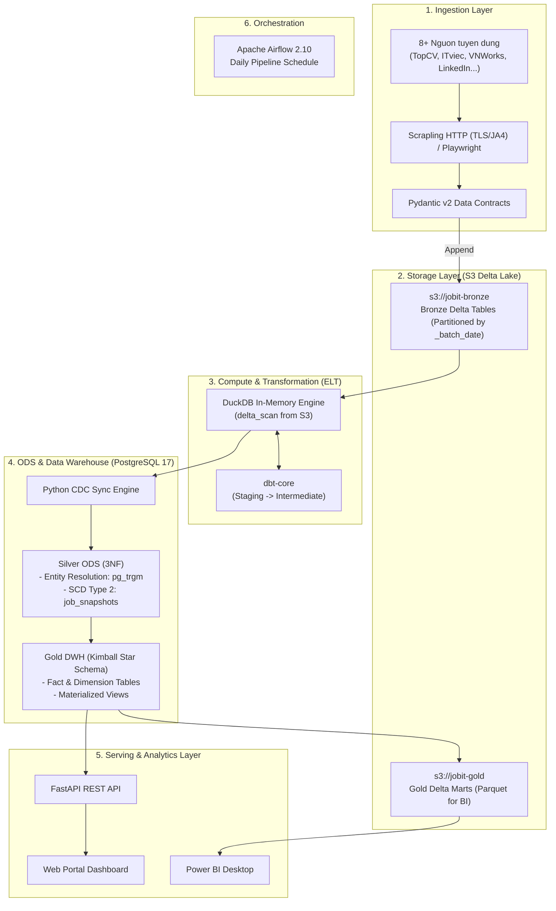

# JobITVN: Medallion Lakehouse & Automated ELT Platform

[](https://www.python.org/)
[](https://airflow.apache.org/)
[](https://delta.io/)
[](https://duckdb.org/)
[](https://www.getdbt.com/)
[](https://www.postgresql.org/)
[](https://fastapi.tiangolo.com/)
[](https://www.docker.com/)
[](LICENSE)

Nền tảng Data Lakehouse thu thập, xử lý và phân tích thị trường việc làm IT tại Việt Nam theo kiến trúc Medallion. Hệ thống tách biệt Storage (S3 Delta Lake) và Compute (DuckDB / PostgreSQL), tự động hóa toàn trình bằng Apache Airflow, áp dụng Change Data Capture (CDC) và Slowly Changing Dimension Type 2 (SCD2), vận hành tối ưu với mức tiêu thụ tài nguyên chỉ ~1.5 GB RAM.

---

## 1. Tong quan & Chi so ky thuat

JobITVN thu thập dữ liệu tuyển dụng từ nhiều nguồn, chuẩn hóa dữ liệu phi cấu trúc, xử lý trùng lặp và phục vụ phân tích trực quan qua Web Dashboard, REST API và Power BI.

| Chi so | Gia tri | Mo ta ky thuat |
|---|---|---|
| Nguon thu thap | 8+ nen tang | TopCV, ITviec, VietnamWorks, LinkedIn, CareerViet, JobsGO, Joboko, 123job |
| Mua tieu thu RAM | ~1.5 GB RAM | Giam 75% so voi kien truc mac dinh, van hanh on dinh tren may ca nhan |
| Giao dich Lakehouse | ACID Compliance | Delta Lake transaction log (`_delta_log`), time-travel, auto-VACUUM |
| Giam thieu I/O DB | 85% - 90% | Watermark CDC ket hop Dual-Hash (`identity_hash` & `content_hash`) |
| Do tre API | < 50ms | PostgreSQL Materialized Views, Connection Pooling va In-Memory TTL Cache |
| Xu ly OLAP | Vai giay / 100K dong | DuckDB In-Memory Columnar Engine ket hop `delta_scan()` truc tiep tu S3 |

---

## 2. Kien truc he thong (Medallion Architecture)



### Phan tang du lieu

| Tang | Vi tri | Dinh dang | Cong nghe | Chuc nang |
|---|---|---|---|---|
| Bronze | `s3://jobit-bronze` | Delta Lake | Python `deltalake` | Luu tru du lieu tho nguyen ban theo phan vung ngay (`_batch_date`), dam bao ACID va time-travel. |
| Silver | PostgreSQL `silver` | Relational 3NF | Python + SQL | Du lieu chuan hoa 3NF, theo doi bien dong voi SCD Type 2, khu trung lap ten cong ty voi `pg_trgm`. |
| Gold | PostgreSQL `dwh` & S3 | Star Schema / Parquet | dbt-core + PostgreSQL | Mo hinh Kimball (Fact/Dimensions) va Materialized Views toi uu cho phan tich BI va REST API. |
| Serving | RAM / REST | JSON / HTML | FastAPI | Cung cap REST endpoints thong ke ky nang, cong ty, muc luong va giao dien Web Dashboard. |

---

## 3. Cong nghe su dung

* Orchestration: Apache Airflow 2.10 (LocalExecutor)
* Ingestion: Scrapling HTTP (TLS/JA4 spoofing), Playwright (Session Cookie Persistence)
* Data Quality: Pydantic v2 (Strict Schema Validation)
* Lakehouse Storage: Delta Lake trên S3 Mock (Floci)
* Compute Engine: DuckDB 1.1+ (Vectorized In-Memory OLAP)
* Data Modeling: dbt-core 1.8+ (dbt-duckdb, dbt-postgres)
* ODS & DWH: PostgreSQL 17 (3NF ODS & Kimball Dimensional Model)
* Serving Layer: FastAPI (QueuePool, TTL Cache), HTML5/CSS3/Vanilla JS
* Analytics: Power BI Desktop (DirectQuery / Import)
* Containerization: Docker & Docker Compose v2

---

## 4. Diem noi bat ky thuat

* Multi-tier Ingestion: Sử dụng Scrapling HTTP giả lập TLS fingerprint (JA3/JA4) cho các trang SSR/API nội bộ (tiêu thụ ~30MB-50MB RAM/tiến trình). Áp dụng Playwright lưu trữ Cookie Session cho các nền tảng có rào cản bot phức tạp (LinkedIn).
* Data Contracts tại nguồn: Toàn bộ dữ liệu thu thập được kiểm định qua Pydantic v2 trước khi ghi vào hồ dữ liệu, ngăn ngừa sai lệch schema.
* Delta Lake ACID Storage: Đảm bảo tính toàn vẹn với transaction log (`_delta_log`), ngăn chặn lỗi hỏng file khi gặp sự cố mạng, tích hợp tác vụ tự động dọn dẹp file cũ (`VACUUM`).
* In-Memory ELT với DuckDB và dbt: Đọc trực tiếp bảng Delta từ S3 qua `delta_scan()`, xử lý biến đổi dữ liệu bằng dbt-core trong RAM mà không cần phụ thuộc cụm Spark nặng nề.
* Watermark CDC & SCD Type 2:
  * `identity_hash = SHA256(source_code, company_raw, location, job_url)`: Định danh duy nhất công việc.
  * `content_hash = SHA256(title, description, salary, requirements, deadline)`: Theo dõi thay đổi nội dung.
  * Khi phát hiện thay đổi nội dung, hệ thống đóng bản ghi cũ và tạo snapshot mới theo chuẩn SCD Type 2, giảm 85% - 90% thao tác ghi I/O dư thừa.
* Fuzzy Entity Resolution: Sử dụng PostgreSQL extensions `pg_trgm` và `unaccent` để chuẩn hóa và gom nhóm các biến thể tên công ty (`similarity > 0.85`) về cùng một `company_id`.
* Toi uu hoa tai nguyen: Giảm mức sử dụng RAM từ 6GB xuống 1.5GB thông qua cấu hình LocalExecutor (gevent), tinh chỉnh bộ đệm PostgreSQL (`shared_buffers = 128MB`), giới hạn DuckDB `max_memory = 512MB`.

---

## 5. Mo hinh du lieu (Data Modeling)

### Tầng Silver (ODS 3NF)
* `silver.companies`: Danh mục doanh nghiệp đã khử trùng lặp.
* `silver.jobs`: Bảng định danh tin tuyển dụng cố định.
* `silver.job_snapshots`: Lịch sử biến động lương, yêu cầu theo chuẩn SCD Type 2 (`valid_from`, `valid_to`, `is_current`).
* `silver.job_events`: Nhật ký trạng thái tin tuyển dụng (`POSTED`, `SALARY_CHANGED`, `CLOSED`).
* `silver.cdc_watermarks`: Mốc thời gian đồng bộ dữ liệu theo từng nguồn.

### Tầng Gold (Kimball Star Schema)
* Fact: `dwh.fct_job_posting` (lương quy đổi VND, số năm kinh nghiệm, trạng thái hoạt động).
* Dimensions: `dwh.dim_company`, `dwh.dim_date`, `dwh.dim_source`, `dwh.dim_job_attributes`.
* Bridge Tables: `dwh.bridge_job_skill`, `dwh.bridge_job_location`.
* Materialized Views: `dwh.mv_active_jobs_summary`, `dwh.mv_salary_by_skill`, `mart_api.latest_jobs_flat`.

---

## 6. Huong dan cai dat & Van hanh

### Yeu cau he thong
* Docker Desktop (hỗ trợ WSL2 trên Windows hoặc Docker Compose v2 trên Linux/macOS).
* Tối thiểu 4GB RAM khả dụng.

### Cai dat
```bash
# 1. Clone repository
git clone https://github.com/chuong1104/CrawlJobITHaNoi.git
cd CrawlJobITHaNoi

# 2. Cau hinh bien moi truong
cp .env.example .env

# 3. Tao thu muc luu tru
mkdir -p logs data/floci data/auth
```

### Khoi chay dich vu
```bash
# Khoi dong Database, S3 Mock va API Web
docker compose up -d postgres floci web-api

# Khoi dong Airflow
docker compose up -d airflow
```

### Danh muc cong ket noi

| Dich vu | Dia chi | Tai khoan | Muc dich |
|---|---|---|---|
| Airflow Webserver | http://localhost:8080 | `admin` / `admin` | Dieu phoi va giam sat pipeline |
| Web Portal | http://localhost:8000 | Khong yeu cau | Tra cuu viec lam va bieu do thong ke |
| FastAPI Swagger | http://localhost:8000/docs | Khong yeu cau | Tai lieu va kiem thu REST API |
| PostgreSQL 17 | `localhost:5432` | `airflow` / `airflow` | Co so du lieu Silver va Gold DWH |
| Floci S3 Mock | http://localhost:4566 | `test` / `test` | Object Storage luu tru Delta Lake |

### Khoi tao co so du lieu & S3 Buckets
Chạy các lệnh sau để khởi tạo cấu trúc bảng:
```bash
docker compose exec airflow psql -U airflow -d job_scraper_db -f /opt/airflow/scripts/sql/silver/01_create_silver_schema.sql
docker compose exec airflow psql -U airflow -d job_scraper_db -f /opt/airflow/scripts/sql/silver/02_create_cdc_tables.sql
docker compose exec airflow psql -U airflow -d job_scraper_db -f /opt/airflow/scripts/sql/gold/01_create_gold_dwh_schema.sql
docker compose exec airflow psql -U airflow -d job_scraper_db -f /opt/airflow/scripts/sql/gold/02_create_materialized_views.sql
docker compose exec airflow env PYTHONPATH=/opt/airflow python -m src.storage.init_buckets
```

### Thuc thi pipeline thu cong (CLI)
```bash
# 1. Thu thap du lieu (Extract -> S3 Delta Bronze)
docker compose exec airflow env PYTHONPATH=/opt/airflow python /opt/airflow/scripts/run_scrapers.py --mode full --workers 3

# 2. Bien doi du lieu bang dbt (DuckDB In-Memory)
docker compose exec airflow dbt run --select staging intermediate --profiles-dir ./dbt_jobitvn --project-dir ./dbt_jobitvn

# 3. Dong bo vao Silver ODS (SCD Type 2)
docker compose exec airflow env PYTHONPATH=/opt/airflow python -m src.silver.sync_engine

# 4. Xuat du lieu Gold Marts ra S3 cho BI
docker compose exec airflow env PYTHONPATH=/opt/airflow python -m src.gold.exporter
```

---

## 7. Cau truc thu muc

```text
job_scraper_de_project/
├── .env.example                  # Cau hinh bien moi truong
├── docker-compose.yml            # Khai bao cac container dich vu
├── Dockerfile                    # Container image tuy chinh
├── requirements.txt              # Thu vien Python phu thuoc
├── dags/
│   └── daily_pipeline.py         # Airflow DAG dieu phoi pipeline
├── dbt_jobitvn/                  # Du an dbt-core (DuckDB & PostgreSQL)
│   ├── models/                   # staging, intermediate, marts
│   └── profiles.yml              # Cau hinh ket noi DuckDB / Postgres
├── src/
│   ├── extract/                  # Scrapers da nguon (TopCV, ITviec, LinkedIn...)
│   ├── schema/                   # Pydantic Data Contracts
│   ├── storage/                  # Quan ly Delta Lake S3 (ACID, VACUUM)
│   ├── silver/                   # CDC Watermarks & 3NF ODS Sync Engine
│   ├── lifecycle/                # Xu ly su kien va lich su SCD Type 2
│   ├── gold/                     # Exporter du lieu ra Delta Lake Marts
│   └── api/                      # FastAPI Serving Layer & Web Portal
├── scripts/                      # SQL migrations va script van hanh
├── docs/                         # Tai lieu kien truc va thiet ke he thong
└── tests/                        # Unit tests va integration tests
```

---

## 8. Tuong thich kien truc Cloud (AWS Cloud Parity)

Hệ thống được thiết kế theo nguyên lý Drop-in Replacement, sẵn sàng ánh xạ 1:1 lên hạ tầng AWS Production mà không cần thay đổi logic xử lý:

| Thanh phan Local | Dich vu tuong duong tren AWS |
|---|---|
| Floci S3 Mock | Amazon S3 (Bronze & Gold Buckets) |
| Local PostgreSQL 17 | Amazon RDS / Aurora PostgreSQL |
| Airflow LocalExecutor | Amazon MWAA (Managed Workflows for Apache Airflow) |
| DuckDB In-Memory Engine | DuckDB on AWS Lambda / AWS Athena |
| FastAPI Container | AWS ECS Fargate / AWS App Runner |

---

## 9. Giay phep (License)

Dự án được phân phối dưới giấy phép [MIT License](LICENSE).
