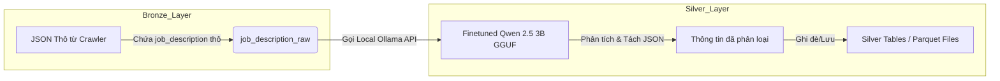

# Hướng Dẫn Finetune Qwen 2.5 3B và Tích Hợp Vào Data Pipeline

Tài liệu này hướng dẫn chi tiết từng bước finetune mô hình **Qwen 2.5 3B (Instruct)** bằng phương pháp **QLoRA** trên Google Colab, xuất ra định dạng **GGUF (chạy CPU)**, triển khai cục bộ qua **Ollama** và tích hợp vào tầng **Silver (Transform)** của Airflow Data Pipeline.

---

## 1. Kiến Trúc Luồng Dữ Liệu (Data Flow)

Trong hệ thống Data Lakehouse, việc trích xuất bằng LLM được định vị tại bước biến đổi từ tầng **Bronze** sang tầng **Silver**:



---

## 2. Chuẩn Bị Dữ Liệu Huấn Luyện (Dataset Preparation)

Để mô hình học được cách trích xuất, cần chuẩn bị từ **500 - 2000** mẫu dữ liệu huấn luyện dạng cặp **Input - Output**.

### Đầu vào (Input):
Đoạn mô tả công việc thô được lấy trực tiếp từ crawler (Bronze Layer).

### Đầu ra mong muốn (Output - Định dạng JSON chuẩn):
```json
{
  "job_type": "Full-time",
  "experience_level": "Senior",
  "education_level": "Đại học",
  "job_industry": "Information Technology",
  "job_position": "Data Engineer",
  "skills": ["Python", "SQL", "Apache Spark", "Airflow", "Docker"]
}
```

### Định dạng File Dataset (`dataset.json`):
Sử dụng cấu trúc hội thoại của Qwen (ChatML):
```json
[
  {
    "messages": [
      {
        "role": "system",
        "content": "Bạn là một trợ lý AI chuyên nghiệp. Hãy trích xuất các thông tin chi tiết từ mô tả công việc được cung cấp và trả về cấu trúc JSON."
      },
      {
        "role": "user",
        "content": "Mô tả công việc: Tuyển dụng Data Engineer tại Hà Nội. Yêu cầu: Trên 3 năm kinh nghiệm làm việc với Python, SQL. Có kiến thức về Spark và Airflow là lợi thế. Tốt nghiệp đại học chuyên ngành CNTT..."
      },
      {
        "role": "assistant",
        "content": "{\"job_type\": \"Full-time\", \"experience_level\": \"Senior\", \"education_level\": \"Đại học\", \"job_industry\": \"Information Technology\", \"job_position\": \"Data Engineer\", \"skills\": [\"Python\", \"SQL\", \"Apache Spark\", \"Airflow\"]}"
      }
    ]
  }
]
```

---

## 3. Huấn Luyện Trên Google Colab (Dùng Unsloth & QLoRA)

Sử dụng thư viện **Unsloth** để finetune nhanh và tiết kiệm VRAM trên GPU T4 miễn phí của Colab.

### Bước 3.1: Cài đặt thư viện trên Colab
```python
!pip install "unsloth[colab-new] @ git+https://github.com/unslothai/unsloth.git"
!pip install --no-deps "xformers<0.0.27" "trl<0.9.0" peft transformers accelerate triton
```

### Bước 3.2: Load Model & Cấu hình QLoRA
```python
import torch
from unsloth import FastLanguageModel

max_seq_length = 2048  # Giới hạn context length phù hợp cho job description dài
dtype = None # Tự động phát hiện (Float16 cho T4/V100, Bfloat16 cho A100)
load_in_4bit = True  # Sử dụng QLoRA 4-bit để tiết kiệm bộ nhớ

model, tokenizer = FastLanguageModel.from_pretrained(
    model_name = "Qwen/Qwen2.5-3B-Instruct",
    max_seq_length = max_seq_length,
    dtype = dtype,
    load_in_4bit = load_in_4bit,
)

# Cấu hình tham số LoRA
model = FastLanguageModel.get_peft_model(
    model,
    r = 16, # Rank của LoRA (độ rộng thích ứng)
    target_modules = ["q_proj", "k_proj", "v_proj", "o_proj", "gate_proj", "up_proj", "down_proj"],
    lora_alpha = 16,
    lora_dropout = 0,
    bias = "none",
    use_gradient_checkpointing = "unsloth", # Tiết kiệm tối đa VRAM
    random_state = 3407,
)
```

### Bước 3.3: Load Dataset và Huấn luyện
```python
from datasets import load_dataset
from trl import SFTTrainer
from transformers import TrainingArguments

# Format dữ liệu theo ChatML template của Qwen
from unsloth.chat_templates import get_chat_template

tokenizer = get_chat_template(
    tokenizer,
    chat_template = "qwen-2.5",
)

def formatting_prompts_func(examples):
    convos = examples["messages"]
    texts = [tokenizer.apply_chat_template(convo, tokenize=False, add_generation_prompt=False) for convo in convos]
    return { "text" : texts }

# Đọc file dataset của bạn
dataset = load_dataset("json", data_files="dataset.json", split="train")
dataset = dataset.map(formatting_prompts_func, batched=True)

# Thiết lập tham số training
trainer = SFTTrainer(
    model = model,
    tokenizer = tokenizer,
    train_dataset = dataset,
    dataset_text_field = "text",
    max_seq_length = max_seq_length,
    dataset_num_proc = 2,
    packing = False, # Có thể chuyển thành True nếu muốn gom các mô tả ngắn lại
    args = TrainingArguments(
        per_device_train_batch_size = 2,
        gradient_accumulation_steps = 4,
        warmup_steps = 5,
        max_steps = 60, # Tăng lên 500-1000 bước tùy thuộc vào lượng data thực tế
        learning_rate = 2e-4,
        fp16 = not torch.cuda.is_bf16_supported(),
        bf16 = torch.cuda.is_bf16_supported(),
        logging_steps = 1,
        optim = "adamw_8bit",
        weight_decay = 0.01,
        lr_scheduler_type = "linear",
        seed = 3407,
        output_dir = "outputs",
    ),
)

trainer_stats = trainer.train()
```

### Bước 3.4: Xuất trực tiếp ra định dạng GGUF 4-bit
Sau khi train xong, dùng Unsloth xuất thẳng ra file GGUF để mang về máy local chạy CPU:
```python
# Xuất mô hình sang dạng GGUF lượng tử hóa 4-bit (phổ biến và tối ưu nhất cho CPU)
model.save_pretrained_gguf("qwen2.5-3b-jobs", tokenizer, quantization_method = "q4_k_m")
```
*Sau bước này, bạn sẽ nhận được file tên là `qwen2.5-3b-jobs-q4_k_m.gguf` trên Google Colab. Hãy tải file này về máy cục bộ.*

---

## 4. Triển Khai Mô Hình Cục Bộ (Local CPU) bằng Ollama

Để tích hợp vào pipeline chạy trên CPU một cách trơn tru, ta sử dụng **Ollama**.

### Bước 4.1: Cài đặt Ollama
*   **Linux (Ubuntu):**
    ```bash
    curl -fsSL https://ollama.com/install.sh | sh
    ```
*   **Docker:** Bạn có thể tích hợp dịch vụ Ollama trực tiếp vào [docker-compose.yml](file:///home/thinkpad/job_scraper_de_project/docker-compose.yml):
    ```yaml
      ollama:
        image: ollama/ollama:latest
        ports:
          - "11434:11434"
        volumes:
          - ./ollama_data:/root/.ollama
        restart: unless-stopped
    ```

### Bước 4.2: Tạo Custom Model trong Ollama
1. Copy file `qwen2.5-3b-jobs-q4_k_m.gguf` vào thư mục của bạn.
2. Tạo một file tên là `Modelfile` cùng thư mục:
   ```dockerfile
   FROM ./qwen2.5-3b-jobs-q4_k_m.gguf

   # Thiết lập tham số hệ thống
   PARAMETER temperature 0.1
   PARAMETER top_p 0.9
   PARAMETER num_ctx 2048

   # System prompt cố định
   SYSTEM "Bạn là một AI chuyên phân tích tin tuyển dụng IT tại Việt Nam. Hãy trích xuất thông tin sang định dạng JSON chính xác theo yêu cầu."
   ```
3. Đăng ký mô hình với Ollama:
   ```bash
   ollama create qwen-job-parser -f Modelfile
   ```

---

## 5. Tích Hợp Vào Airflow Data Pipeline (Silver Layer)

### Bước 5.1: Xây dựng Module gọi API phân tích trong Python
Tạo hoặc tích hợp hàm sau vào dự án (Ví dụ tại [src/utils.py](file:///home/thinkpad/job_scraper_de_project/src/utils.py) hoặc module xử lý dữ liệu mới):

```python
import json
import logging
import requests
from typing import Optional

logger = logging.getLogger("pipeline.llm_parser")

def extract_job_details_local(description: str, ollama_url: str = "http://localhost:11434") -> Optional[dict]:
    """
    Gửi mô tả công việc thô qua Ollama API chạy mô hình Qwen 2.5 3B để trích xuất JSON.
    """
    prompt = f"Hãy trích xuất thông tin từ mô tả tuyển dụng sau:\n\n{description}"
    
    try:
        response = requests.post(
            f"{ollama_url}/api/generate",
            json={
                "model": "qwen-job-parser",
                "prompt": prompt,
                "stream": False,
                "format": "json" # Bắt buộc Ollama ép định dạng đầu ra là JSON sạch
            },
            timeout=30
        )
        if response.status_code == 200:
            result_str = response.json().get("response", "")
            return json.loads(result_str)
        else:
            logger.error(f"Ollama API error {response.status_code}: {response.text}")
    except Exception as e:
        logger.error(f"Failed to parse job description using Local LLM: {e}")
    
    return None
```

### Bước 5.2: Tích hợp vào Airflow DAG (Silver Transform Task)
Nhiệm vụ này sẽ đọc danh sách job thô từ **Bronze (Local JSON / S3)** $\rightarrow$ gửi qua Ollama $\rightarrow$ lưu dữ liệu đã được phân tích vào **Silver**:

```python
from airflow.decorators import task
from src.aws.s3_client import S3ClientWrapper
from src.config import DATA_PROCESSED_DIR
import json

@task
def transform_bronze_to_silver_with_llm(date_str: str):
    """
    Đọc dữ liệu thô từ Bronze S3, sử dụng LLM cục bộ trích xuất, 
    và lưu kết quả sạch sang Silver.
    """
    s3 = S3ClientWrapper()
    # 1. Download file dữ liệu thô từ Bronze
    raw_keys = s3.list_objects(bucket_name="jobit-bronze", prefix=f"raw/")
    
    # Tìm file của ngày chạy hiện tại
    target_key = next((k for k in raw_keys if date_str in k), None)
    if not target_key:
        print("No raw data found for date:", date_str)
        return
        
    # Giả định tải về & load dict
    # ... code download file thô ...
    raw_jobs = [...] 
    
    processed_jobs = []
    for job in raw_jobs:
        raw_desc = job.get("job_description", "")
        # Gọi hàm LLM để trích xuất thông tin
        extracted_data = extract_job_details_local(raw_desc, ollama_url="http://ollama:11434")
        
        if extracted_data:
            # Ghi đè/cập nhật các trường thông tin nhỏ
            job.update({
                "job_type": extracted_data.get("job_type"),
                "experience_level": extracted_data.get("experience_level"),
                "education_level": extracted_data.get("education_level"),
                "job_industry": extracted_data.get("job_industry"),
                "job_position": extracted_data.get("job_position"),
                "skills": extracted_data.get("skills", [])
            })
        processed_jobs.append(job)
        
    # 2. Lưu file đã xử lý ra tầng Silver (Local và upload S3 'jobit-silver')
    # ... code lưu file và upload s3 ...
```

---

## 6. Kỹ Thuật Tối Ưu Hóa (Performance & Cost Optimization)

1.  **Chỉ gửi qua LLM khi cần thiết:**
    *   Trước khi gọi LLM, kiểm tra xem tin tuyển dụng có thực sự thuộc lĩnh vực CNTT hay không bằng từ khóa cơ bản (Regex/Dict) để tránh lãng phí tài nguyên CPU.
    *   Chỉ cập nhật những tin tuyển dụng mới cào (dựa trên `job_id` chưa tồn tại trong Silver/DW).
2.  **Lập lịch thời gian chạy:**
    *   Nên chạy tác vụ Transform LLM vào ban đêm (Ví dụ: 2h sáng) khi Airflow Server nhàn rỗi, tránh ảnh hưởng đến các tác vụ crawl ban ngày.
3.  **Sử dụng JSON Mode trong Ollama:**
    *   Luôn cài đặt thuộc tính `"format": "json"` khi gọi API Ollama. Việc này giúp mô hình không trả về các ký tự chào hỏi thừa thãi (như *"Dưới đây là JSON của bạn..."*) giúp việc `json.loads` trong Python không bao giờ bị lỗi cú pháp.
4.  **Lượng tử hóa Q4_K_M:**
    *   Việc lượng tử hóa xuống 4-bit giúp mô hình chỉ ngốn ~2.2GB RAM, giảm thiểu tải tối đa cho máy chủ CPU thông thường.

---

## 7. Cấu Hình Tối Ưu Nhất Cho Hệ Thống (Production Design)

Để tích hợp bền vững vào hệ thống Data Pipeline đang chạy Docker hiện tại, dưới đây là phương án **tối ưu nhất về mặt kiến trúc**:

### 7.1. Cấu hình Ollama thành Service độc lập trong `docker-compose.yml`
Thêm `ollama` vào file Docker Compose để tách biệt tài nguyên tính toán với Airflow:

```yaml
  ollama:
    image: ollama/ollama:latest
    container_name: job_scraper_ollama
    ports:
      - "11434:11434"
    volumes:
      - ./data/ollama:/root/.ollama
    # Giới hạn tài nguyên để không làm đơ hệ thống khi CPU chạy 100%
    deploy:
      resources:
        limits:
          cpus: '4.0' # Giới hạn sử dụng tối đa 4 core CPU
          memory: 4096M
    restart: unless-stopped
```

### 7.2. Tối ưu Code Python với Pydantic (Structured Outputs của Ollama)
Từ phiên bản `ollama` SDK mới, bạn có thể truyền thẳng cấu trúc Pydantic để đảm bảo kết quả trả về khớp 100% định dạng bạn mong muốn, không lo LLM trả về thiếu trường hoặc sai định dạng:

```python
from pydantic import BaseModel
from typing import List
import ollama

# 1. Định nghĩa Schema đầu ra bằng Pydantic
class JobSchema(BaseModel):
    job_type: str          # Full-time, Part-time, Remote, Hybrid
    experience_level: str  # Intern, Junior, Senior, Manager
    education_level: str   # Đại học, Cao đẳng, Không yêu cầu
    job_industry: str      # IT, Marketing, Logistics...
    skills: List[str]      # ["Python", "SQL", "Airflow"]

# 2. Hàm gọi mô hình tối ưu nhất
def parse_job_description(description: str) -> JobSchema:
    client = ollama.Client(host="http://ollama:11434")
    
    response = client.chat(
        model="qwen-job-parser",
        messages=[
            {
                "role": "user",
                "content": f"Hãy phân tích và trích xuất thông tin từ tin tuyển dụng sau:\n\n{description}"
            }
        ],
        # Ép định dạng JSON theo đúng cấu trúc Pydantic Schema
        format=JobSchema.model_json_schema(),
        options={
            "temperature": 0.0, # Độ chính xác cao nhất, không sáng tạo
            "num_predict": 256  # Giới hạn độ dài output để tăng tốc độ sinh từ
        }
    )
    
    # Kết quả trả về là một Object Pydantic đã được kiểm định kiểu dữ liệu
    return JobSchema.model_validate_json(response['message']['content'])
```

### 7.3. Áp dụng cơ chế cào gia tăng (Incremental Loading)
Tuyệt đối **không chạy lại LLM đối với các job cũ đã được xử lý**.
*   **Luồng xử lý:** Khi task Silver bắt đầu, so sánh danh sách `job_id` trong thư mục Bronze mới tải về với danh sách `job_id` đã có sẵn tại Silver (S3/Database).
*   **Chỉ gửi qua Ollama:** Những `job_id` mới chưa từng tồn tại ở Silver. Điều này giúp giảm tải 95% khối lượng công việc cho CPU trong các lần chạy hàng ngày.

### 7.4. Cài đặt Pool Throttling trong Airflow
Vì mô hình chạy bằng CPU local, nếu Airflow chạy song song nhiều task hoặc xử lý đồng thời quá nhiều luồng (multithreading/multiprocessing), CPU sẽ bị quá tải (100%) dẫn đến sập container.
*   **Giải pháp:** Tạo một **Airflow Pool** tên là `llm_pool` với `Slots = 1`. Gán task Transform LLM vào pool này để đảm bảo tại một thời điểm chỉ có duy nhất 1 luồng xử lý LLM hoạt động.

